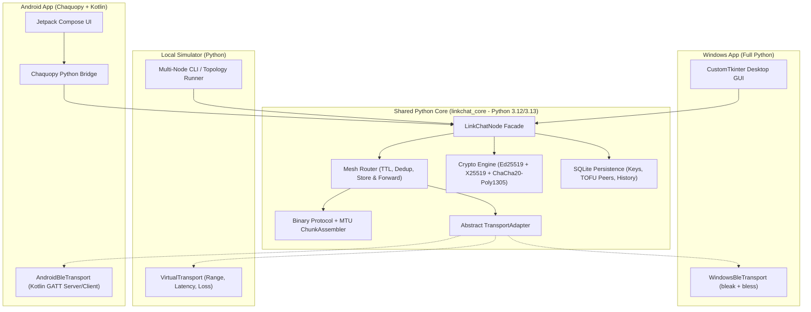

# LinkChat — Cross-Platform Bluetooth Mesh Messenger

**LinkChat** is an offline, decentralized, BitChat-inspired Bluetooth Low Energy (BLE) mesh messenger designed to work seamlessly across **Windows** and **Android**. Built around a shared Python core (`linkchat_core`), it enables zero-infrastructure group chat and end-to-end encrypted direct messaging over multi-hop BLE connections.

---

## 1. Project Goals & Scope

### Core Requirements
- **Public Group Chat**: Broadcast text messages across all connected nodes in the local BLE mesh, relayed automatically over multiple hops.
- **End-to-End Encrypted Direct Messages (DMs)**: Private 1-to-1 messaging between any two reachable nodes in the mesh, unreadable by intermediate relay nodes.
- **Cross-Platform Interoperability**: Windows (10/11) and Android (10+) devices discover, connect, relay, and chat seamlessly over a shared BLE GATT protocol without requiring manual Bluetooth pairing.
- **Python-First Architecture**: Mesh routing, binary framing, chunking, persistence, and cryptography live in one pure-Python package (`linkchat_core`) shared by Windows (native CPython) and Android (via Chaquopy).

### Added Mesh & Demo Features (Balanced MVP)
1. **Multi-Hop Mesh Relay**: TTL-bounded flooding with `(origin_id, msg_id)` deduplication and jittered forwarding so out-of-range devices (`Phone A <-> Laptop B <-> Phone C`) communicate through intermediate peers.
2. **Live Peer Radar**: Displays discovered peers with connection state, direct vs. `N-hop` distance badge, signal strength (RSSI), and verification status.
3. **Identity & Safety Fingerprints**: Zero-account `Ed25519`/`X25519` identity with Trust On First Use (TOFU), key-change warnings, and a 6-group safety number + 6-emoji fingerprint for in-person MITM verification.
4. **Store-and-Forward Caching**: Caches recent public messages and undelivered DMs locally and reconciles missed packets when peers join or reconnect.
5. **Local Python Mesh Simulator**: Runs 5+ virtual `LinkChatNode` instances on a single machine over a simulated radio graph (`VirtualTransport`) for repeatable multi-hop demos and automated testing.

---

## 2. System Architecture



### Design Rationale
- **Shared Brain, Native Radio on Android**: Running `linkchat_core` inside Android via **Chaquopy** (which supports Python 3.12/3.13 and provides pre-compiled `cryptography` wheels) eliminates duplicate protocol/crypto code while letting **Kotlin** manage Android's `BluetoothLeAdvertiser`, `BluetoothGattServer`, `BluetoothLeScanner`, and `BluetoothGatt` APIs directly.
- **Full Python on Windows**: Windows runs `linkchat_core` directly with `CustomTkinter` for the desktop UI and `bleak` + `bless` for BLE communication.

---

## 3. Repository Structure

```text
mesh-chat/
├── PROJECT.md
├── pyproject.toml                  # Workspace dependencies & pytest config
├── core/
│   └── linkchat_core/
│       ├── __init__.py
│       ├── identity.py             # Ed25519 + X25519 keys, node_id, safety fingerprints
│       ├── crypto.py               # Public signing & ChaCha20-Poly1305 DM AEAD
│       ├── protocol.py             # Binary packet codec & MTU ChunkAssembler
│       ├── cache.py                # Seen-packet LRU/TTL & store-and-forward buffer
│       ├── router.py               # Multi-hop relay, peer table, digest sync
│       ├── storage.py              # SQLite persistence (identity, peers, messages)
│       ├── transport.py            # Abstract TransportAdapter & link events
│       └── node.py                 # High-level LinkChatNode async facade
├── windows/
│   └── linkchat_win/
│       ├── __init__.py
│       ├── ble_transport.py        # bleak (Central) + bless (Peripheral + fallback)
│       ├── app.py                  # Asyncio-to-Tkinter event loop bridge
│       └── ui/
│           ├── main_window.py      # Chat view, Peer Radar sidebar, Mesh Inspector
│           ├── verify_dialog.py    # Safety number & emoji fingerprint verification
│           └── theme.py            # UI styling constants
├── android/
│   └── LinkChatAndroid/
│       ├── build.gradle.kts        # Chaquopy 3.13 + cryptography + Compose setup
│       └── app/src/main/
│           ├── python/bridge.py    # Thin Kotlin <-> LinkChatNode adapter
│           └── java/com/linkchat/
│               ├── ble/            # AndroidBleTransport, GATT Server/Client, Service
│               ├── model/          # UI state models & permission helpers
│               └── ui/             # Jetpack Compose screens & dialogs
├── simulator/
│   └── linkchat_sim/
│       ├── __init__.py
│       ├── virtual_transport.py    # Graph topology, latency, drop-rate radio mock
│       └── cli_demo.py             # Interactive 5+ node mesh & reconnect scenarios
└── tests/
    ├── test_protocol_chunking.py
    ├── test_crypto_identity.py
    ├── test_router_multihop.py
    └── test_store_and_forward.py
```

---

## 4. BLE GATT Profile & Link Layer

### Shared GATT Service Specification
All LinkChat nodes expose and scan for the same custom 128-bit Service UUID:

| Component | UUID / Role | Properties |
| :--- | :--- | :--- |
| **Service UUID** | `7b4e1000-8f2a-4c3b-9d1e-4c696e6b4368` | Advertised in primary BLE advertisement |
| **RX Characteristic** | `7b4e1001-8f2a-4c3b-9d1e-4c696e6b4368` | `Write`, `Write Without Response` (Central -> Peripheral) |
| **TX Characteristic** | `7b4e1002-8f2a-4c3b-9d1e-4c696e6b4368` | `Notify` (Peripheral -> Central) |

> [!NOTE]
> The trailing bytes `4c696e6b4368` spell ASCII `"LinkCh"`. Advertisement payload includes the 128-bit Service UUID and short local name (`LC-<4hex>`, using the first 4 hex chars of `node_id`) so scanners filter LinkChat devices immediately without connecting to unrelated BLE peripherals.

### MTU Chunking & Reassembly (`ChunkAssembler`)
`ChunkAssembler` lives inside **`linkchat_core`** so neither Windows nor Android has to reimplement fragmentation in platform code. Platform transports only send/receive raw BLE characteristic byte chunks and report the link's negotiated ATT MTU on `on_link_up`.

BLE ATT payloads default to 20 bytes (`MTU 23 - 3`) and negotiate up to 247–512 bytes when supported. `ChunkAssembler` splits outbound packets into chunks sized to `max(20, link_mtu - 3)`:

```text
+------------+--------------+----------+-----------+-------------------------+
| flags (1B) | frame_id(2B) | seq (1B) | total(1B) | chunk_payload (N bytes) |
+------------+--------------+----------+-----------+-------------------------+
```

- `flags`: Bit `0` = single-frame shortcut (`total == 1`); remaining bits reserved.
- `frame_id`: Per-link wrapping 16-bit sequence ID.
- `seq` / `total`: Zero-based chunk index and total chunk count (max 255 chunks; max logical packet size capped at **4,096 bytes** to bound memory on mobile/BLE).
- Incomplete frames expire after **5 seconds** to prevent memory leaks from dropped links.

### Connection Management & Windows Fallback
- **Deterministic Tie-Breaker**: When two dual-role nodes discover each other, the node with the lexicographically **smaller `node_id`** initiates the GATT connection as **Central**, preventing duplicate redundant links and conserving scarce BLE connection slots (typically 4–7 concurrent connections on mobile radios).
- **Windows Central-Only Fallback**: On Windows, `bleak` handles the Central role reliably, while `bless` provides the Peripheral GATT Server. If a Windows machine's Bluetooth driver or adapter rejects `GattServiceProvider` advertising at startup, `WindowsBleTransport` logs a capability warning, marks itself `central_only=True`, and initiates Central connections to nearby Android Peripherals—preserving full chat and multi-hop relay participation.

---

## 5. Binary Wire Protocol & Mesh Routing

### Packet Header Format (Big-Endian)
Total fixed header size: **28 bytes**.

```text
Offset  Size  Field       Description
0       1B    version     Protocol version (0x01)
1       1B    pkt_type    Packet type enum
2       8B    msg_id      Random 64-bit unique message identifier
10      8B    origin_id   Sender's 8-byte node_id
18      8B    target_id   Recipient node_id (all 0x00 for broadcast)
26      1B    ttl         Remaining hops (default: 5, max: 7)
27      1B    hop         Hops traversed so far (starts at 0)
28      var   payload     Type-specific binary payload
```

### Packet Types

| Code | Name | Target | Payload Contents |
| :--- | :--- | :--- | :--- |
| `0x01` | `HELLO` | Broadcast (`ttl=1`) | `caps (1B)` + `nick_len (1B)` + `nickname (UTF-8)` + `ed25519_pub (32B)` + `x25519_pub (32B)` |
| `0x02` | `CHAT_PUBLIC` | Broadcast (`ttl=5`) | `timestamp_ms (8B)` + `text_len (2B)` + `text (UTF-8)` + `ed25519_sig (64B)` |
| `0x03` | `CHAT_DM` | `target_id` (`ttl=5`) | `timestamp_ms (8B)` + `nonce (12B)` + `ciphertext_and_tag (var)` |
| `0x04` | `DM_ACK` | `target_id` (`ttl=5`) | `acked_msg_id (8B)` + `nonce (12B)` + `ciphertext_and_tag (var)` (encrypts `b"ACK"` with AAD including `acked_msg_id`) |
| `0x05` | `SYNC_DIGEST` | Direct peer (`ttl=1`) | `count (2B)` + `N * msg_id (8B each)` of cached public messages |
| `0x06` | `SYNC_REQ` | Direct peer (`ttl=1`) | `count (2B)` + `N * msg_id (8B each)` missing from local store |

### Routing, Deduplication & Store-and-Forward
1. **Link-Up Handshake**: Immediately when `on_link_up(handle, mtu, rssi)` fires, the node sends `HELLO` on that link. Upon receiving a peer's `HELLO`, it sends `SYNC_DIGEST` containing its cached public `msg_id`s, replies to the peer's `SYNC_DIGEST` with `SYNC_REQ` for any unseen `msg_id`s, and flushes any queued outbound DMs whose `target_id` is now reachable.
2. **Deduplication**: Every node maintains an in-memory LRU/TTL `seen_cache` keyed by `(origin_id, msg_id)` holding up to 2,000 entries. Duplicates are dropped immediately.
3. **Loop-Free Multi-Hop Forwarding**:
   - Validate header version, payload bounds, and (for `CHAT_PUBLIC`) the `Ed25519` signature before relaying so malformed or forged public packets cannot flood the mesh.
   - If `ttl > 1` and the packet is not a `CHAT_DM` / `DM_ACK` addressed to self: construct a forwarded copy with `ttl - 1` and `hop + 1`, wait a random jitter (`15–60 ms`), and send to all connected neighbors **except** the neighbor that delivered it.
4. **Peer Table Updates**: Direct `HELLO` packets record `hop_count = 1` and live RSSI; relayed `CHAT_PUBLIC` / `HELLO` packets update reachability (`hop_count = packet.hop + 1` or minimum observed hop count) with a configurable stale timeout (e.g., 90 seconds).
5. **Store-and-Forward Reconciliation**:
   - Each node caches the last **100 public messages** (max age 2 hours) and any **undelivered outbound DMs** (max age 24 hours).
   - Missing cached `CHAT_PUBLIC` packets requested via `SYNC_REQ` are replayed directly over the requesting link while preserving the original `msg_id` and `Ed25519` signature.

---

## 6. Cryptography, Identity & Verification

All cryptographic operations use standard primitives from Python's `cryptography` library:

- **Identity Generation**:
  - `Ed25519` private/public keypair (signing & identity).
  - `X25519` private/public keypair (Diffie-Hellman key agreement).
  - `node_id = SHA256(ed25519_pub)[:8]` (displayed as 16 lowercase hex chars or shortened `4-char` tag alongside nickname).
- **Public Message Authenticity (`CHAT_PUBLIC`)**:
  - Sender signs `header_without_ttl_hop || timestamp_ms || text` with `Ed25519`.
  - Signing excludes mutable `ttl` and `hop` bytes so intermediate relay nodes can decrement `ttl` and increment `hop` without invalidating the sender's signature.
- **Direct Message E2EE (`CHAT_DM` & `DM_ACK`)**:
  1. Compute `shared_secret = X25519(my_x25519_priv, peer_x25519_pub)`.
  2. Derive symmetric key via `HKDF-SHA256`:
     - `salt = min(id_a, id_b) || max(id_a, id_b)`
     - `info = b"linkchat-dm-v1"`
     - `length = 32` bytes
  3. Encrypt plaintext with `ChaCha20Poly1305` using a fresh random 12-byte nonce (`os.urandom(12)`) and **Associated Data (`AAD`)** = `version || pkt_type || msg_id || origin_id || target_id || timestamp_ms`, preventing routing-metadata tampering or cross-context replay.
- **TOFU & Safety Fingerprints**:
  - On first contact, a peer's `(ed25519_pub, x25519_pub)` is saved to SQLite (`verified = False`). If a previously seen `node_id` presents a different key, the UI raises an explicit **Key Changed Warning**.
  - **Safety Fingerprint**: `digest = SHA256(b"linkchat-fp-v1" || min(ed_a, ed_b) || max(ed_a, ed_b))` formatted as:
    - **Safety Number**: Six 5-digit numeric groups (30 digits total).
    - **Emoji Hash**: 6 deterministic emojis mapped from the first 6 bytes of `digest` for quick visual comparison across screens.

---

## 7. Core Module Interfaces

`LinkChatNode` exposes a single clean async API consumed identically by the Windows GUI, Android Chaquopy bridge, and Simulator. It requires `data_dir: str | Path` (used for SQLite identity/peer/history persistence) and a `TransportAdapter` that exchanges raw BLE chunks (chunking/reassembly happens inside `LinkChatNode` via `ChunkAssembler`):

```python
class TransportAdapter(Protocol):
    async def start(self) -> None: ...
    async def stop(self) -> None: ...
    async def send_chunk(self, peer_handle: str, chunk: bytes) -> None: ...
    def set_callbacks(
        self,
        on_link_up: Callable[[str, int, int], Awaitable[None]],      # handle, mtu, rssi
        on_link_down: Callable[[str], Awaitable[None]],
        on_chunk: Callable[[str, bytes], Awaitable[None]],
    ) -> None: ...
```

Key `LinkChatNode` constructor & methods:
- **Init**: `LinkChatNode(data_dir: str | Path, transport: TransportAdapter, nickname: str | None = None)`
- **Commands**: `start()`, `stop()`, `set_nickname(name)`, `send_public(text)`, `send_dm(target_id, text)`, `verify_peer(node_id, verified=True)`, `get_peers()`, `get_safety_fingerprint(node_id)`, `get_history(channel_or_peer)`.
- **UI Event Callbacks**: `on_peer_updated(PeerInfo)`, `on_public_message(MessageRecord)`, `on_dm_received(MessageRecord)`, `on_dm_status_changed(msg_id, status)`, `on_mesh_log(LogEntry)`.

### Dependencies & Packaging (`pyproject.toml`)
- **Core (`linkchat_core`)**: `cryptography>=42.0` (only external dependency; everything else uses stdlib `asyncio`, `sqlite3`, `struct`, `hashlib`).
- **Tests & Simulator**: `pytest>=8.0`, `pytest-asyncio>=0.23` (`pythonpath = ["core", "windows", "simulator"]`).
- **Windows (`linkchat_win`)**: `customtkinter>=5.2`, `bleak>=0.22`, `bless>=0.2.6`.

---

## 8. Platform Implementation Details

### Windows Desktop App (`linkchat_win`)
- **Storage & UI Framework**: Defaults `data_dir` to `~/.linkchat` (or `%LOCALAPPDATA%/LinkChat`). `CustomTkinter` runs on the main thread, polling a `queue.Queue` every 50 ms driven by a dedicated background `asyncio` daemon thread hosting `LinkChatNode` + `WindowsBleTransport`.
- **Views**:
  - **Setup / Profile Bar**: Edit local nickname, view own `node_id` & BLE mode badge (`Dual-Role` vs `Central-Only`).
  - **Peer Radar Sidebar**: Live list of peers showing nickname, `Direct` or `N hops` pill, RSSI bar, and Verified (`✓`) / Key-Warning (`!`) icon. Clicking a peer opens their Encrypted DM tab or Safety Fingerprint modal.
  - **Chat Workspace**: Switchable `#public` channel and per-peer DM tabs with delivery badges (`Sending` -> `Relayed` -> `Delivered`).
  - **Mesh Inspector Drawer** (collapsible): Live trace of `HELLO`, relayed packets (`ttl`, `hop`), and `SYNC` events for university presentation demos.

### Android App (`LinkChatAndroid`)
- **Gradle & Chaquopy**: `minSdk = 26`, `targetSdk = 35`, `compileSdk = 35`, `com.chaquo.python` configured for Python `3.13` with `pip { install "cryptography" }` and `arm64-v8a` / `x86_64` ABI filters. Point Chaquopy's Python `srcDir` directly at `../../core` (so `linkchat_core` is never duplicated) plus `src/main/python` for `bridge.py`. Pass `context.filesDir.absolutePath` as `data_dir` to `LinkChatNode`.
- **Kotlin BLE Layer (`AndroidBleTransport`)**:
  - Runs inside an Android **Foreground Service** (`connectedDevice` type) so BLE scanning/advertising stays alive during chats.
  - Requests runtime permissions cleanly for Android 12+ (`BLUETOOTH_SCAN`, `BLUETOOTH_ADVERTISE`, `BLUETOOTH_CONNECT`, `POST_NOTIFICATIONS`) and Android 10–11 (`ACCESS_FINE_LOCATION`).
  - Bridges incoming BLE frames and connection events to `bridge.py` on a single serialized background executor so Python core state remains thread-safe.
- **Jetpack Compose UI**: Material 3 screens matching Windows (`#public` chat, Peer Radar with hop badges, DM threads, Safety Fingerprint verification sheet).

### Local Python Simulator (`linkchat_sim`)
- `VirtualTransport` routes frames across an in-memory `NetworkHub` representing an undirected graph of nodes with configurable edge latency (`ms`) and packet drop rate (`%`).
- Built-in CLI demo scenarios:
  1. **5-Node Linear Chain** (`Alice - Bob - Carol - Dave - Eve`): `Alice` sends `#public` and an encrypted DM to `Eve`; console logs prove intermediate nodes (`Bob`, `Carol`, `Dave`) relay ciphertext without being able to decrypt it.
  2. **Partition & Reconnect**: Disconnect `Carol`, send messages on `Alice`, reconnect `Carol`, and observe `SYNC_DIGEST` / `SYNC_REQ` catch-up delivery.

---

## 9. Phased Implementation Roadmap

### Phase 1 — Shared Core & Virtual Simulator
- Implement `identity.py`, `crypto.py`, `protocol.py`, `cache.py`, `router.py`, `storage.py`, `transport.py`, and `node.py`.
- Implement `linkchat_sim` (`VirtualTransport` + 5-node CLI demo).
- Write full `pytest` suite in `tests/`.
- **Exit Criteria**: All `pytest` tests pass; 5-node simulated chain delivers `#public`, E2EE DMs + `DM_ACK`, and store-and-forward catch-up cleanly.

### Phase 2 — Windows Desktop Application
- Implement `WindowsBleTransport` (`bleak` Central + `bless` Peripheral + automatic Central-only fallback).
- Build `CustomTkinter` GUI (Peer Radar, `#public`, E2EE DMs, Safety Fingerprint modal, Mesh Inspector drawer).
- **Exit Criteria**: Windows PC discovers, connects, and chats with Android test client (or two Windows laptops if both support Peripheral mode).

### Phase 3 — Android Application (Kotlin + Chaquopy)
- Scaffold Android Studio Gradle project with Chaquopy embedding `linkchat_core`.
- Implement `AndroidBleTransport` (GATT Server + Advertiser + Scanner + Client + Foreground Service + runtime permissions).
- Build Jetpack Compose UI screens (Chat, Peer Radar, DM, Safety Fingerprint dialog).
- **Exit Criteria**: APK builds and runs on Android 10+ devices; discovers nearby Android and Windows LinkChat nodes.

### Phase 4 — Cross-Platform Interop Testing & Demo Polish
- Verify end-to-end **Windows <-> Android** direct group chat, E2EE DM + `DM_ACK`, and Safety Fingerprint verification.
- Verify **3-node physical multi-hop** (`Phone A <-> Windows Laptop <-> Phone B`, using a debug `blocked_macs`/`blocked_ids` filter on the phones if in the same room to simulate physical separation).
- Package reproducible setup & demo instructions in `README.md`.

---

## 10. Verification Plan

### Automated Tests (`pytest`)
- **Protocol & Chunking**: Round-trip encode/decode for all packet types; `ChunkAssembler` fragmentation/reassembly across 20-byte and 247-byte MTUs, out-of-order rejection, and incomplete-frame timeout cleanup.
- **Cryptography & Identity**: `Ed25519` signature verification and rejection of tampered public messages; `X25519` + `HKDF` + `ChaCha20-Poly1305` DM decryption and failure on modified ciphertext or header `AAD`; deterministic Safety Number and Emoji Fingerprint symmetry (`fp(A, B) == fp(B, A)`).
- **Routing & Store-and-Forward**: Deduplication loop prevention on cyclic graphs; TTL expiration (`ttl == 1` not forwarded); 5-node chain relay; `SYNC_DIGEST` catch-up after simulated disconnect/reconnect.

### Physical Hardware Acceptance Tests
1. **Direct Windows <-> Android**: Exchange `#public` messages, initiate E2EE DM, verify matching 6-emoji fingerprint on both screens, confirm `Delivered` receipt via `DM_ACK`.
2. **Windows Central-Only Fallback**: Simulate/test a Windows adapter without Peripheral mode connecting to an Android Peripheral and participating normally in group chat and DMs.
3. **3-Node Multi-Hop Relay**: Route a message from `Phone A` through `Windows Laptop` to `Phone B` with direct `A <-> B` link disabled, verifying `hop = 2` on `Phone B` and encrypted DM delivery.

---

## 11. Running Each Phase in a Fresh Session

Each phase is self-contained and can be started in a new conversation by referencing `PROJECT.md` and `AGENTS.md`:

- **Phase 1**: *"Implement Phase 1 from PROJECT.md: `pyproject.toml`, `core/linkchat_core`, `simulator/linkchat_sim`, and `tests/`. Run `pytest` and verify the 5-node demo."*
- **Phase 2**: *"Implement Phase 2 from PROJECT.md: `windows/linkchat_win` (`WindowsBleTransport` with `bleak` + `bless` Central-only fallback, and `CustomTkinter` UI). Keep `linkchat_core` tests green."*
- **Phase 3**: *"Implement Phase 3 from PROJECT.md: `android/LinkChatAndroid` (Kotlin Jetpack Compose + `AndroidBleTransport` + Foreground Service + Chaquopy `bridge.py` pointing to `core/linkchat_core`)."*
- **Phase 4**: *"Run Phase 4 from PROJECT.md: cross-platform Windows <-> Android interop fixes, 3-node multi-hop verification, and final `README.md` setup/demo instructions."*

